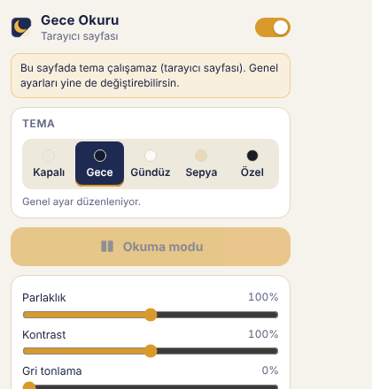
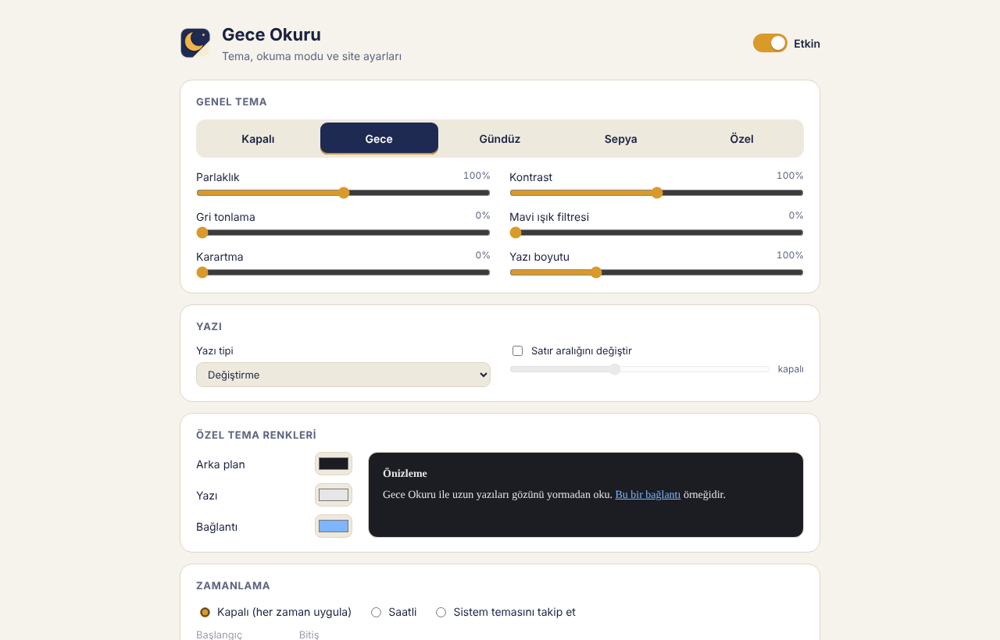

# Gece Okuru — Dark Mode & Reader Mode for Every Site

A Chrome extension (Manifest V3) that adds **dark / light / sepia themes, a clean reading mode, text-to-speech and a blue-light filter** to any website, with per-site settings.

*Her siteye karanlık / aydınlık / sepya tema, okuma modu, sesli okuma, mavi ışık filtresi ve site bazlı ayarlar.*

| Popup | Settings |
|---|---|
|  |  |

## Features

- **Themes:** Off, Night, Day, Sepia and a custom theme with your own colors
- **Fine controls:** brightness, contrast, grayscale, blue-light filter, dimming, font size, font family, line height
- **Reading mode:** strips a page down to the article text
- **Text-to-speech** in reading mode
- **Per-site settings:** each site can keep its own theme and settings
- **Schedule:** always on, by time range, or follow the system theme
- **Shortcuts:** `Alt+Shift+D` theme on/off · `Alt+Shift+R` reading mode · `Alt+Shift+M` next theme
- No tracking, no server — settings stay in `chrome.storage`

## Install (developer mode)

1. Download or clone this repository.
2. Open `chrome://extensions` and turn on **Developer mode** (top right).
3. Click **Load unpacked** and select this folder.

## Structure

```
manifest.json        MV3 manifest, permissions, shortcuts
background.js        context menu, shortcuts, per-tab state
shared/common.js     shared settings helpers
content/theme.js     theme engine (runs at document_start to avoid white flash)
content/reader.js    reading mode + text-to-speech
popup/               quick controls
options/             full settings page
_locales/tr/         Turkish strings
```

## License

MIT — see [LICENSE](LICENSE).
